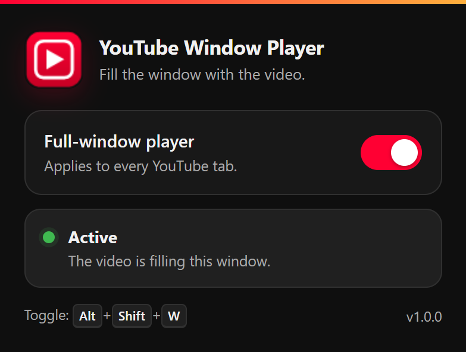

<div align="center">


# YouTube Window Player

**Make the YouTube player fill your entire browser window — width and height — with the masthead and page content scrolling below it.**

[](https://www.mozilla.org/firefox/)
[](https://developer.chrome.com/docs/extensions/)
[](LICENSE)
[](https://github.com/Rob1ts/Resize-Youtube-Player-to-Window-Size-Extension/releases/latest)

[Install](#installation) · [What it does](#what-it-does) · [The popup](#the-popup) · [How it works](#how-it-works) · [Build](#development)

</div>

---

## What it does

YouTube normally caps the player to a column about half the window wide, with
the recommendations sidebar sitting next to it. This extension pins the player
to the top of the page and stretches it to the full width and height of the
window. The masthead moves below the video, and comments, recommendations, and
the rest of the page start underneath it instead of competing for space.

The video keeps its aspect ratio — wide videos are letterboxed with black bars
rather than cropped or stretched.

## The popup



The toolbar popup has one switch and a live status panel:

- **Active** — the player really is filling the window.
- **Disabled** — the switch is off.
- **Fullscreen** — YouTube's native fullscreen is active; the extension stays
  out of the way.
- **Ready** — you are on YouTube, but not on a watch page.
- **Starting…** — the player is still loading.
- **Video unavailable** — the extension waits for the next playable video.
- **Not applied** — YouTube changed its layout and the resize did not take.
- **Reload needed** — the tab was open before the extension was installed or
  updated; reload it.

The switch applies to every open YouTube tab, and the toolbar badge follows the
current tab (`ON`, empty, `!`, or `OFF`).

## Features

- Fills the window in both directions, at any window size.
- Works with YouTube's single-page navigation (home → video → home).
- Toggle from the popup or with `Alt+Shift+W`.
- Live status detection instead of a switch that only remembers a preference.
- Native fullscreen, theater state, and player settings are left untouched.
- Second YouTube tabs follow the global on/off setting immediately.
- Dark and light popup themes, reduced-motion support, and keyboard-accessible
  controls.
- No telemetry, no accounts, no remote code, and no network requests of its own.

## Installation

### Chromium browsers (Chrome, Edge, Brave, Opera, Vivaldi, Chromium)

**Recommended: load the unpacked build**

1. Open `chrome://extensions` (or the equivalent page in your browser).
2. Turn on **Developer mode**.
3. Click **Load unpacked** and select the `Chromium/` folder in this repository.

Alternatively, download `youtube-window-player-chromium.crx` from the
[latest release](https://github.com/Rob1ts/Resize-Youtube-Player-to-Window-Size-Extension/releases).
Modern Chrome, Edge, and most Chromium browsers block extensions that were not
installed from their store, so the CRX may be rejected. Loading `Chromium/` as
an unpacked extension is the method that works without enterprise policy or a
store listing.

### Firefox

The XPI is **unsigned**. Firefox release builds require store signing for a
permanent install, so use the temporary-install flow. The manifest keeps the
existing AMO add-on ID (`resize-yt-to-window-size@local`) and uses version
`141.0.0`, so uploading this package updates the existing **Resize YT To Window
Size** listing instead of creating a new add-on.

1. Open `about:debugging#/runtime/this-firefox`.
2. Click **Load Temporary Add-on…**.
3. Select `Firefox/manifest.json` (or the `.xpi` from the latest release).

The extension stays installed until Firefox restarts. To make it permanent,
sign the package as an unlisted add-on with an AMO API key:

```bash
npx web-ext sign \
  --source-dir Firefox \
  --channel=unlisted \
  --api-key=YOUR_AMO_KEY \
  --api-secret=YOUR_AMO_SECRET
```

or submit a ZIP of `Firefox/` on <https://addons.mozilla.org/developers/> (or the
XPI itself). Once signed, the resulting XPI installs normally in Firefox release.

## Usage

1. Open any YouTube watch page. The video fills the window automatically.
2. Click the toolbar icon to turn the mode off or on. The setting is global.
3. Press `Alt+Shift+W` to toggle without opening the popup.
4. Change the shortcut in `chrome://extensions/shortcuts` (Chromium) or
   `about:addons` → gear menu → **Manage Extension Shortcuts** (Firefox).

If the popup says **Reload needed** after installing or updating the extension,
use the button in the popup or reload the YouTube tab.

Native fullscreen is deliberately excluded: entering fullscreen hands control
back to YouTube, and leaving it restores the full-window layout.

## How it works

The extension does not patch YouTube's history API, click YouTube's theater
button, or alter the player's JavaScript state. It adds a single class to the
page's `<html>` element and lets a small, static CSS file:

- pin `#player-container` to the viewport,
- resize the player and video to 100% of that container,
- add a viewport-height margin before YouTube's app content,
- position the masthead directly below the video,
- leave everything untouched while `html[fullscreen]` is present.

Because the class lives on `<html>`, it is applied before the player is created
and is removed automatically when you leave a watch page.

The content script also measures `#movie_player` after each state change. The
popup reports **Active** only when the class is present *and* the player's
rendered size matches the viewport, so a silent YouTube layout change shows up
as **Not applied** instead of a false success.

## Permissions and privacy

- `storage` — remembers the single on/off boolean.
- `https://youtube.com/*` and `https://*.youtube.com/*` — runs the content
  script and stylesheet on YouTube and lets the popup talk to those tabs.

No `tabs` permission is requested. The extension never reads browsing history,
does not inject into other sites, and makes no network requests of its own.
There is no analytics, telemetry, remote code, or external service.

## Security notes

- All JavaScript, CSS, and icons are packaged locally. No remote scripts, no
  `eval`, no `new Function`, and no dynamic code construction.
- The popup writes text with `textContent` only; it never inserts page-controlled
  data into the DOM.
- The content script accepts messages only from this extension's own ID, and
  only the two known message types with validated payloads.
- Settings changes and tab reloads are accepted only from extension pages, not
  from content scripts or web pages; a tab-hosted copy of `popup.html` is
  rejected too.
- The extension-page CSP is locked down to local resources with
  `connect-src 'none'`.
- The content script runs in an isolated world and exposes no privileged APIs to
  the page.

## Status and badge reference

| Popup status | Badge | Meaning |
| --- | --- | --- |
| Active | `ON` | Player fills the window |
| Fullscreen | `ON` | Native YouTube fullscreen is active |
| Starting… | `ON` | Waiting for the player |
| Ready | *(none)* | YouTube, but not a watch page |
| Disabled | `OFF` | Switch is off |
| Video unavailable | `!` | No playable video on this page |
| Not applied | `!` | Layout did not take effect; reload |
| Not on YouTube | *(none)* | Current tab is another site |

## Repository layout

```text
Chromium/     Ready-to-load Manifest V3 build (generated)
Firefox/      Ready-to-load Firefox Manifest V3 build (generated)
src/          Canonical source: scripts, styles, popup, manifests, icons
tools/        Build script, CRX packer, icon generator
docs/         Logo and popup screenshot used by this README
THIRD-PARTY-NOTICES.md   Upstream MIT attribution
```

`Chromium/` and `Firefox/` are generated by `tools/build.mjs`. Edit `src/`, then
run the build; do not edit the generated folders by hand.

## Development

Requirements: Node.js 18+, plus 7-Zip (or PowerShell on Windows) for packaging.
Packing the CRX additionally needs Chrome or Edge; set `CHROME_PATH` if the
browser is not in a standard location.

```bash
npm run icons   # regenerate PNG icons (Windows PowerShell + System.Drawing)
npm run build   # generate Chromium/, Firefox/, the release zip and xpi
npm run crx     # pack release/youtube-window-player-chromium.crx (after build)
```

`npm run build` recreates `release/`, so run `npm run crx` after it. The CRX
signing key is kept in `keys/youtube-window-player.pem`, which is gitignored;
preserve it if you publish updates under the same extension ID. Override the
location with `CRX_KEY_PATH`.

## Testing

Automated checks for this build:

**Chromium (Chrome for Testing 156, real YouTube, headed)**

- Player fills the viewport at 1280×720, 1024×768, 1920×1080, and 800×600;
  `scrollY` stays at 0 and there is no horizontal overflow.
- The real toolbar popup was opened through `chrome.action.openPopup()` and
  checked for Active, Disabled, Fullscreen, Ready, and Not-on-YouTube states.
- Toggle off restores YouTube's normal player; toggle on re-applies it; the
  setting persists and the badge follows it.
- SPA navigation home → video → home updates the layout in both directions.
- A second YouTube tab follows the global toggle.
- Simulated fullscreen disables the layout rules and leaving it restores them.
- Tab-hosted extension pages cannot change settings (sender check).

**Firefox 158 (temporary XPI, real YouTube, headed)**

- Player fills a 1280×789 viewport with the masthead directly below it.
- The popup page loads and renders.
- Turning the setting off and on through `storage.local` applies and removes
  the layout; SPA navigation back home clears it.

## Known limitations

- The extension targets the desktop YouTube layout (`ytd-watch-flexy` /
  `ytd-watch-grid`). YouTube Shorts and the mobile site are intentionally not
  resized.
- YouTube changes its DOM regularly. If the player stops filling the window,
  the popup reports **Not applied**; a selector update may be needed.
- The included Firefox XPI is unsigned; permanent installation requires AMO
  signing as described above.
- Modern Chrome/Edge may refuse a locally built CRX. Use the unpacked build or a
  store/policy installation.

## Credits and license

This project is a derivative work of
[ResizeYoutubePlayerToWindowSize](https://github.com/Zren/ResizeYoutubePlayerToWindowSize/)
by **Chris H (Zren / Shade)**. The original userscript's layout technique is the
foundation for this extension; the extension code, popup, build tooling, and
icons are a new implementation.

This program is free software: you can redistribute it and/or modify it under
the terms of the **GNU General Public License v3.0 or later** as published by
the Free Software Foundation. See [LICENSE](LICENSE).

The upstream userscript is distributed under the MIT License according to its
metadata. Its copyright and permission notice are reproduced in
[THIRD-PARTY-NOTICES.md](THIRD-PARTY-NOTICES.md). MIT-licensed code can be
incorporated into a GPL-3.0 work when that notice is preserved; using
GPL-3.0-or-later keeps this project compatible with both the upstream README's
GPL statement and its MIT metadata.

This project is not affiliated with or endorsed by YouTube, Google, or the
original author.

## Links

- **Repository** — <https://github.com/Rob1ts/Resize-Youtube-Player-to-Window-Size-Extension>
- **Releases** — <https://github.com/Rob1ts/Resize-Youtube-Player-to-Window-Size-Extension/releases>
- **Original project** — <https://github.com/Zren/ResizeYoutubePlayerToWindowSize/>
- **Original userscript** — <https://greasyfork.org/scripts/811-resize-yt-to-window-size>
- Chrome Web Store listing — *pending*
- AMO listing — *pending*
